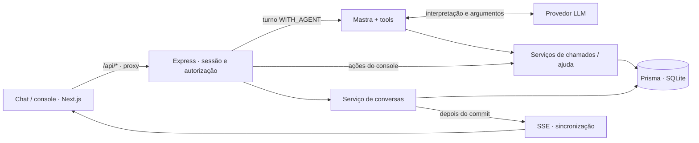

# Nexo Assist

Agent de service desk de TI desenvolvido para um desafio técnico. O funcionário tira dúvidas pela central de ajuda, consulta seus chamados, confere propostas de abertura/complemento/reabertura e pede atendimento humano. O analista acompanha a fila, assume a conversa com o agent pausado, responde, devolve ou encerra o atendimento.

A implementação usa dados fictícios e segue os fluxos e regras dos Anexos A/B do PRD. A referência visual está no [design system e nas telas do protótipo](docs/design-system/README.md). O projeto pode ser executado localmente; não há deploy publicado documentado neste repositório.

## Sumário

- [Como rodar](#como-rodar)
- [Variáveis de ambiente](#variáveis-de-ambiente)
- [Demonstração](#demonstração)
- [Arquitetura](#arquitetura)
- [Como o agent decide](#como-o-agent-decide)
- [Transparência e continuidade](#transparência-e-continuidade)
- [Prazos de atendimento (SLA)](#prazos-de-atendimento-sla)
- [Qualidade e evidências](#qualidade-e-evidências)
- [Modelo e controle de custo](#modelo-e-controle-de-custo)
- [Trade-offs e limitações](#trade-offs-e-limitações)
- [Deploy e próximos passos](#deploy-e-próximos-passos)
- [Uso de IA no desenvolvimento](#uso-de-ia-no-desenvolvimento)
- [Referência da API](#referência-da-api)

## Como rodar

Use **Node.js 22.14+ da linha 22** e npm; as verificações registradas usaram Node 22.14.0. Há um `package-lock.json` por aplicação e nenhum comando de instalação na raiz. Você precisará de uma chave de LLM compatível com o modelo configurado.

### Preparação inicial

**Atenção: `db:setup`, `db:seed` e `db:reset` apagam dados existentes.** O seed limpa usuários, artigos, chamados, eventos, conversas e mensagens antes de recriar a demonstração. Execute a preparação abaixo somente em banco local novo ou descartável. Confirme `DATABASE_URL` antes de executá-la.

No terminal do backend, partindo da raiz:

```bash
cd backend
cp .env.example .env
# Preencha LLM_API_KEY em .env e confira DATABASE_URL.
npm ci
npm run db:setup
npm run dev
```

`npm ci` também gera o Prisma Client pelo `postinstall`. `db:setup` aplica as migrations, gera o client e executa o seed destrutivo. A API inicia em `http://localhost:8000`; `GET /health` retorna `{ "status": "ok" }`. A inicialização verifica a conexão com o banco e exige a chave da LLM.

Em outro terminal, também partindo da raiz:

```bash
cd frontend
cp .env.example .env.local
npm ci
npm run dev
```

Abra `http://localhost:3000/login`. No PowerShell, pode usar `Copy-Item .env.example .env` e `Copy-Item .env.example .env.local` no lugar de `cp`.

### Reinício normal e builds

Para retomar o trabalho, execute somente `npm run dev` em cada diretório. Mantenha o mesmo banco e o mesmo `SESSION_SECRET`; não repita o seed. Se houver migrations novas no repositório, `npm run db:deploy` aplica as existentes sem popular novamente os dados.

| Diretório | Comando | Finalidade |
|---|---|---|
| `backend/` | `npm run build` / `npm start` | Compila TypeScript / executa `dist/server.js` |
| `frontend/` | `npm run build` / `npm start` | Gera o build Next / serve o build |
| `backend/` | `npm run db:generate` | Gera o Prisma Client |
| `backend/` | `npm run db:migrate` | Cria/aplica migrations em desenvolvimento após mudança de schema |
| `backend/` | `npm run db:studio` | Abre o Prisma Studio |

O build do frontend exige `API_PROXY_TARGET` e usa `next/font/google`, que pode precisar baixar fontes. Esses comandos foram conferidos contra os manifests; esta revisão documental não executou instalação limpa, migrations ou builds.

## Variáveis de ambiente

Copie os exemplos [backend/.env.example](backend/.env.example) e [frontend/.env.example](frontend/.env.example). Valores reais de chaves ficam fora do versionamento.

| Backend | Obrigatória | Finalidade/padrão |
|---|---|---|
| `DATABASE_URL` | Sim | SQLite, por exemplo `file:./dev.db`. Execute os comandos a partir de `backend/` para manter o caminho relativo consistente |
| `SESSION_SECRET` | Sim | Assinatura da sessão, mínimo de 32 caracteres; valor de exemplo recusado em produção |
| `CORS_ORIGINS` | Sim | Origens exatas permitidas, separadas por vírgula, sem `*`, caminho ou barra final |
| `LLM_API_KEY` | Sim | Chave do provedor; para o modelo padrão, Google AI Studio |
| `AGENT_MODEL` | Não | `google/gemini-3.5-flash-lite` |
| `AGENT_TIMEOUT_MS` | Não | `120000`, timeout do turno completo |
| `TICKET_SERVICE_SIMULATION` | Não | `off`; `down` simula indisponibilidade dos chamados e é recusado em produção |
| `NODE_ENV` | Não | `production` ativa `Secure` no cookie |
| `PORT` | Não | `8000` |

| Frontend | Obrigatória | Finalidade/padrão |
|---|---|---|
| `API_PROXY_TARGET` | No build de produção | URL do backend. Em desenvolvimento, padrão `http://localhost:8000`. Os rewrites ficam gravados no build |

O navegador envia `/api/*` ao Next, que encaminha a chamada à API. Assim o cookie fica associado à origem do frontend. As rotas da [referência da API](#referência-da-api) usam caminhos do backend: `/chat` corresponde a `/api/chat` no navegador.

## Demonstração

O login tem e-mail e senha. **Qualquer senha não vazia é aceita para as identidades abaixo**: o backend verifica o e-mail cadastrado, não uma senha real. A sessão dura 8 horas, com cookie `httpOnly`, `SameSite=Lax` e `Secure` em produção. O papel é relido do banco em cada requisição.

| Funcionário | E-mail |
|---|---|
| Marina Costa | `marina.costa@nexo.example` |
| Juliana Alves | `juliana.alves@nexo.example` |
| Ana Souza | `ana.souza@nexo.example` |

| Analista | E-mail |
|---|---|
| Rafael Lima | `rafael.lima@nexo.example` |
| Bruno Martins | `bruno.martins@nexo.example` |

Use janelas/perfis separados para manter uma sessão de funcionário e outra de analista. O funcionário entra em `/console/employee`; o analista, em `/console/analyst`. Os dados têm datas relativas à execução do seed; testes e interações posteriores mudam seu estado.

| Fluxo | Como demonstrar |
|---|---|
| Ajuda e fonte | Pergunte “Qual o horário do suporte?”; expanda “Como decidi” e “Ler artigo”. Em VPN/erro 809, informe o sistema operacional para conferir aplicabilidade |
| Consulta | Com Marina, peça seus chamados e selecione um resultado; consulte `INC-20311` para ver vencimento. Se a conversa recuperada estiver esperando analista, devolva pelo console primeiro |
| Proposta e confirmação | Relate um problema de TI e quem é afetado. Confira classificação e rascunho; cancele um e confirme outro. Preparar não cria chamado |
| Duplicidade/reabertura | Com Marina, descreva o notebook do chamado aberto; peça reabertura de `INC-20150` (dentro da janela no seed recente) e de `INC-19987` (fora dela) |
| Atendimento humano | Peça analista; no outro perfil, assuma, responda, confira o resumo e devolva. O agent permanece pausado durante espera/atendimento. Encerrar conversa não resolve automaticamente o chamado |
| Continuidade e escopo | Recarregue durante um rascunho/atendimento. Pergunte sobre férias e depois sobre acesso à pasta do Financeiro: o primeiro é RH, o segundo continua TI |

A conversa recuperada é a ativa mais recente, não uma fixture escolhida por nome. Na demonstração inicial de Marina, a conversa transferida pode vir antes da fixture de limite. Ana dispõe de uma conversa já devolvida ao agent para experimentar novas dúvidas. **Iniciar nova conversa** aparece quando a conversa está encerrada ou atingiu a cota; o histórico anterior permanece salvo.

<details>
<summary>Conversas preparadas pelo seed</summary>

O seed traz conversas com ids fixos para demonstração:

| Id | Dono | Estado |
|---|---|---|
| `seed-conv-closed` | Marina | Encerrada, sem analista |
| `seed-conv-near-limit` | Marina | Com o agent, com 29 mensagens: a próxima é aceita e a seguinte recebe o `409` |
| `seed-conv-waiting` | Juliana | Esperando analista (chamado crítico) |
| `seed-conv-request` | Ana | Esperando analista (pedido da pessoa) |
| `seed-conv-low-confidence` | Juliana | Esperando analista (baixa confiança) |
| `seed-conv-overdue` | Marina | Esperando analista (chamado vencido, `ticketCode` INC-20311) |
| `seed-conv-returned` | Ana | Atendida pelo Bruno e devolvida ao agent |
| `seed-conv-closed-by-analyst` | Juliana | Encerrada pelo Rafael há 3 h |
| `seed-conv-with-analyst` | Rafael | Atendida pelo Bruno (`WITH_ANALYST`), com o INC-20405 ainda aguardando analista |

`seed-conv-with-analyst` tem Rafael como dono, apesar de seu papel de analista: serve à demonstração do console, não ao chat de funcionário. Como Bruno, selecione essa conversa e altere `INC-20405` de “Aguardando analista” para “Em andamento” no painel. Para selecionar uma fixture no console, use `/console/analyst?conversation=ID`.

</details>

## Arquitetura

| Camada | Implementação e responsabilidade |
|---|---|
| Interface | Next.js 16, React 19, TypeScript estrito, Tailwind CSS, Zod, React Hook Form e TanStack Query; módulos em Feature-Sliced Design |
| API | Express, sessão por cookie assinado, autorização por papel/propriedade, contratos Zod e rotas de chat/console/artigos |
| Agent | Mastra interpreta o pedido e chama tools; a resposta estruturada é validada e composta antes da gravação |
| Serviços | Chamados simulados, central de ajuda e ciclo de vida da conversa, separados do modelo |
| Persistência | Prisma com SQLite pelo adapter libSQL: usuários, artigos, chamados/eventos, conversas, mensagens, transparência e rascunho pendente |
| Sincronização | SSE em memória, publicado depois do commit e filtrado por usuário/papel |



O contexto do agent vem das últimas 20 mensagens persistidas da conversa. As tools consultam serviços e registram propostas: não acessam o banco diretamente. ChatService revalida a saída; ConversationService confirma/grava a resposta, o rascunho ou a transferência. A confirmação de chamado é uma operação separada, sem LLM.

| Local | Conteúdo |
|---|---|
| `frontend/app/` e `frontend/src/` | Rotas Next e camadas da interface |
| `backend/src/api/`, `auth/`, `chat/`, `console/` | HTTP, sessão e orquestração dos dois papéis |
| `backend/src/agent/` | Instruções, runner, tools, composição e avaliações |
| `backend/src/tickets/`, `knowledge/`, `conversations/` | Serviços e regras de domínio |
| `backend/src/realtime/`, `shared/` | SSE, tipos, contratos e resiliência |
| `backend/prisma/` e `backend/src/db/` | Schema/migrations, cliente e dados de demonstração |

## Como o agent decide

1. A API identifica o funcionário pela sessão e reserva o turno em sua conversa. Em `WAITING_ANALYST`/`WITH_ANALYST`, apenas grava a mensagem para atendimento humano, sem chamar a LLM.
2. Em `WITH_AGENT`, o runner envia à LLM o histórico com autoria do analista identificada; as tools recebem também o contexto do rascunho atual. A LLM interpreta a mensagem, escolhe tools e pergunta o que falta.
3. As tools consultam somente chamados do dono da sessão ou a central de ajuda. Abertura reúne título, descrição, tipo, categoria, prioridade e afetados; a LLM propõe classificação por impacto/urgência. O backend limita crítica a impacto coletivo.
4. Abertura, complemento e reabertura produzem propostas. Essas escritas só acontecem no botão de confirmação, que revalida propriedade, estado e regra aplicável; cancelar não cria chamado nem consome número.
5. A transferência validada leva um resumo e é persistida junto da resposta, passando a conversa para espera. “Proposta aceita” pela tool ainda não significa que a transação foi gravada.
6. A composição combina a decisão com resultados reais das tools, aplica respostas de segurança, preserva impedimentos relevantes e grava resposta/transparência. Só depois do commit publica os eventos para as telas.

| Tool | Finalidade |
|---|---|
| `searchMyOpenTickets` | Consulta chamados abertos próprios por código, características ou lista |
| `searchHelpCenter` | Busca até três artigos; respeitar aplicabilidade depende também da interpretação do modelo |
| `draftTicket` | Detecta semelhantes, pede dados faltantes e propõe uma criação |
| `draftComplement` | Propõe acrescentar informação a chamado aberto próprio |
| `draftReopen` | Verifica resolvido/janela de sete dias e propõe reabertura com motivo |
| `transferToAnalyst` | Valida motivo/resumo e propõe atendimento humano; não escolhe o analista |

**Regras garantidas pelo backend:** identidade e propriedade, papéis, contratos, estados, cota de mensagens, janela de reabertura, cálculo de SLA, confirmação e transações condicionais. O modelo não pode trocar o dono por argumento de tool. Consultas retornadas e ações executadas vêm dos serviços/recorder, não de afirmações livres da LLM. Isso não torna toda a linguagem gerada determinística nem elimina erros de classificação/interpretação.

**Duplicidade e ajuda:** a busca textual de semelhantes exige uma decisão antes de uma criação nova; o caminho de complemento evita duplicar o mesmo problema. O fluxo admite reconhecer sugestões anteriores e preparar outro chamado se o funcionário indicar que é um caso diferente. Similaridade não prova equivalência. A central possui oito artigos fictícios, com busca por palavras/categoria, timeout de 2 s e até duas tentativas. “Não resolveu” encaminha o relato para rascunho com a orientação tentada. Uma pergunta sobre aplicabilidade pode acompanhar o aviso de duplicidade com sua fonte, sem recomendar um procedimento incompatível.

**Transferência:** pedido explícito registra `EMPLOYEE_REQUEST`; baixa confiança admite `LOW_CONFIDENCE`; consulta de um único chamado vencido gera oferta, e seu aceite na resposta seguinte permite `OVERDUE`. Recusas atuais/recentes impedem insistência automática. Confirmar um chamado crítico transfere automaticamente, regra separada de vencimento. A devolução pelo analista mantém os mesmos critérios, sem proibição geral de nova transferência.

O resumo usa o rascunho atual quando disponível, incluindo relato/tentativas, impacto informado e confirmação pendente. Sem contexto estruturado, mantém o resumo do modelo com limitação explícita para consultar o histórico. Códigos desconhecidos são rejeitados; códigos não validados no relato são omitidos desse contexto. O console exibe “Resumo da última transferência”; devolver limpa esse campo e o rascunho. Não há chamada adicional à LLM só para compor o resumo.

**Falhas:** leituras do serviço de chamados têm timeout de 3 s e até duas tentativas. Uma confirmação indisponível mantém o rascunho para retry. Erro de LLM retorna `503 AGENT_UNAVAILABLE` e desfaz o turno reservado. Mensagens e eventos de conversa são diferentes de comentários/eventos de chamado; responder no chat do analista não atualiza automaticamente um chamado.

## Transparência e continuidade

“Como decidi” está disponível nas mensagens do agent no chat e no console, inclusive no histórico:

| Campo exibido | Origem |
|---|---|
| O que entendi | `understood`: descrição resumida do pedido |
| Ação tomada | `actions`: ferramenta, resumo e status — realizada, falhou ou não realizada |
| Grau de segurança | `confidence`: Alta, Média ou Baixa |
| Justificativa | `reason`: justificativa registrada para a resposta |

Entendimento, segurança e justificativa partem da saída estruturada e podem receber fallbacks/ajustes do código. Ações derivam das execuções do turno, distinguindo proposta, bloqueio e operação confirmada. Esse registro legível não é acesso ao raciocínio interno do modelo; a segurança declarada não é uma probabilidade calibrada. Fontes validadas ficam em `trace.sources` e abrem o artigo completo; expandir a explicação não chama a LLM.

Ao abrir o chat, `GET /chat/conversations/active` recupera a conversa elegível mais recente do funcionário: `WITH_AGENT`, `WAITING_ANALYST` ou `WITH_ANALYST`, ordenada por `lastMessageAt` e depois `id`, ambos decrescentes. Encerradas não são retomadas automaticamente. Sem elegível, o chat fica vazio; falha de leitura mostra erro/retry, sem criar conversa nova.

A recuperação traz histórico, estado/analista, cota e proposta pendente válida. O novo turno usa até 20 mensagens anteriores, inclusive as do analista; mensagens antigas continuam no banco, mas não há busca geral entre conversas nem memória entre conversas independentes. Anexos de consultas e rascunhos novos são snapshots da mensagem. Cards antigos que não foram registrados não são reconstruídos por suposição.

Refresh, logout/login e reinício podem continuar a mesma conversa mantendo banco e segredo de sessão. Recuperar a tela não chama a LLM. A cota é de **30 mensagens do funcionário ao agent por conversa**, não por login: mensagens durante atendimento humano não a consomem. A 30ª é permitida; a 31ª é recusada. Após devolução, a cota continua de onde parou.

O frontend separa cache por usuário, limpa/cancela no logout e ressincroniza depois de conectar o SSE. **Iniciar nova conversa** só cria o registro no próximo envio; recarregar antes disso volta a recuperar a ativa anterior. SSE sincroniza mensagens/estados completos; `POST /chat` retorna a resposta completa em JSON, sem streaming de tokens.

## Prazos de atendimento (SLA)

O Anexo A exige os prazos abaixo para a **primeira resposta e cada atualização**, em vez de um prazo único de resolução. Como referência operacional, adotamos o expediente do exemplo do Anexo B: **segunda a sexta, das 8h às 18h**, com **plantão 24h para crítica**.

| Prioridade | Prazo do Anexo A | Contagem adotada |
|---|---|---|
| Crítica | 1 hora | 60 minutos corridos, inclusive noites, fins de semana e virada de data |
| Alta | 4 horas úteis | 240 minutos acumulados apenas no expediente |
| Média | 3 dias úteis | 30 horas acumuladas de expediente (3 × 10h) |
| Baixa | 5 dias úteis | 50 horas acumuladas de expediente (5 × 10h) |

**Convenções de calendário:** o PRD não define a conversão de dias úteis. Preservamos a interpretação existente de acumular horas de expediente, coerente com a contagem da alta, sem avançar simplesmente três ou cinco datas úteis. Assim, uma média aberta segunda às 8h vence quarta às 18h; uma baixa, sexta às 18h. Fora do expediente, o saldo começa no próximo dia útil às 8h. Uma alta aberta sexta às 17h consome 1h na sexta e 3h na segunda, vencendo **segunda às 11h**. Às 18h não começa contagem nova, mas um prazo pode terminar exatamente nesse horário.

**Fuso e feriados:** o calendário usa **UTC−3 fixo**, referência operacional de São Paulo, com cálculos por timestamp e métodos UTC; não depende do fuso do servidor. Não implementamos regras históricas de horário de verão. As datas persistidas e da API são instantes UTC/ISO com `Z`; mensagens geradas pelo backend formatam o horário em UTC−3, enquanto os cards da interface exibem no fuso do navegador, sem recalcular o SLA. Não há calendário de feriados: segunda a sexta contam mesmo em feriados, inclusive 1º de janeiro se cair em dia de semana. São escolhas operacionais para o desafio, não exigências explícitas do PRD.

**Eventos do prazo:** como o PRD não enumera quais atualizações renovam o SLA, o motor usa eventos do chamado para representar a primeira resposta e a próxima atualização do suporte:

| Evento | Efeito no prazo |
|---|---|
| `CREATED`, na confirmação da abertura | Inicia a primeira janela; preparar um rascunho não inicia o SLA. O prazo do rascunho é uma prévia |
| `STATUS_CHANGED` para `IN_PROGRESS` ou `APPROVED` | Inicia janela cheia a partir da mudança, inclusive se a anterior venceu |
| `COMMENT` do analista, com prazo ativo | Inicia janela cheia para a próxima atualização |
| `STATUS_CHANGED` para `WAITING_EMPLOYEE` | Pausa: `slaStartedAt` e `dueAt` ficam null |
| Complemento confirmado pelo funcionário em `WAITING_EMPLOYEE` | Gera retorno automático para `WAITING_ANALYST` e janela cheia a partir da confirmação; não reaproveita saldo anterior |
| `REOPENED`, na confirmação da reabertura | Inicia janela cheia, mantendo a prioridade |
| `STATUS_CHANGED` para `RESOLVED` | Encerra o SLA ativo e limpa o prazo |
| Demais comentários do funcionário/agent, comentário do analista durante pausa ou `TRANSFERRED` | Não renovam nem reativam o prazo |
| `PRIORITY_CHANGED` | Com SLA pausado, só muda a prioridade. Elevar usa o menor entre o prazo atual e o calculado desde a mudança; rebaixar recalcula desde `slaStartedAt`, sem iniciar outra janela |

Essa distinção impede que um complemento do funcionário adie a resposta devida pelo suporte. `updatedAt` sozinho não renova o SLA. Uma mensagem do analista na **conversa** também não cria um comentário no **chamado**, pois não há associação obrigatória entre ambos. O console atual atualiza chamados por mudanças de status; comentários do analista e mudanças de prioridade já são tratados no motor/histórico, mas não têm ações próprias na interface.

**Vencimento e transferência:** o chamado fica vencido apenas quando `now > dueAt`; no instante exato ainda está no prazo. Prazo null (pausado ou resolvido) nunca está vencido. Chat e console usam a mesma regra. Na consulta de um único chamado vencido, o agent acrescenta a oferta de analista; a transferência por `OVERDUE` exige o aceite dessa oferta na resposta seguinte e respeita recusas atuais ou recentes. Uma lista com vários chamados não dispara essa oferta específica. A transferência automática na confirmação de um chamado crítico é uma regra separada do vencimento. Os testes usam relógios fixos e modelo fake, incluindo limites de milissegundos e execução com diferentes fusos de servidor.

## Qualidade e evidências

A verificação combina três mecanismos, com alcances diferentes:

| Mecanismo | O que verifica | Como conferir / evidência |
|---|---|---|
| Testes determinísticos | Regras, contratos, autorização/propriedade, persistência, transações/concorrência, falhas e composição | [Testes da API F01–F03](backend/src/api/chat-essential-context.test.ts), [runner com modelo fake](backend/src/agent/agent-runner.test.ts), [SLA](backend/src/tickets/sla.test.ts), demais `*.test.ts` e testes do frontend |
| Avaliação com LLM real | Seleção de tools, argumentos, escopo, condições de artigos e respostas em cenários controlados | [decisions.real.ts](backend/src/agent/decisions.real.ts); serviços de chamados fake, LLM real e critérios específicos por caso |
| Navegador | Interação, renderização e sincronização, complementadas por API/logs/leituras persistidas | Rodadas locais em Chrome headless com sessões separadas e cópia isolada do SQLite; resultados resumidos abaixo |

Comandos comuns, **sem LLM real**, a partir da raiz:

```bash
cd backend
npm run typecheck
npm test
```

```bash
cd frontend
npx tsc --noEmit
npm run lint
npm test
```

Na execução registrada em **04/11/2026**, passaram **1.131 testes no backend e 507 no frontend**, além dos typechecks e lint do frontend. São resultados daquela execução, não garantia de versões futuras nem percentual de cobertura. A revisão do README não repetiu as suítes. O backend usa bancos temporários; há uma queda intermitente conhecida de encerramento do libSQL no Windows, descrita em [test-database.ts](backend/src/db/test-database.ts); a última suíte completa terminou com exit 0.

Para avaliar o modelo configurado, execute manualmente em `backend/`:

```bash
npm run eval:agent
npm run eval:agent -- help
npm run eval:agent -- create
npm run eval:agent -- complement
npm run eval:agent -- returned
npm run eval:agent -- out-of-scope
npm run eval:agent -- waiting
```

Esses comandos carregam `.env`, usam credenciais e consomem tokens reais. A saída indica aprovação/falha de critérios por cenário e métricas do turno; o comportamento pode variar entre execuções/modelos. O avaliador não substitui os testes de persistência ou a validação da interface. Sua existência não implica que todos os cenários tenham sido aprovados na versão atual.

**Navegador:** a rodada inicial teve 9 grupos aprovados, 3 com falhas e 1 inconclusivo. As falhas de resumo de transferência, explicação da janela de reabertura e aplicabilidade de artigo (F01–F03) foram corrigidas e passaram em revalidação direcionada. O ramo novo `LOW_CONFIDENCE` após devolução ficou inconclusivo no navegador: o modelo não chamou a tool; existe cobertura determinística desse ramo. Exclusividade foi observada por atribuição/segunda tentativa recusada, sem corrida exatamente simultânea no navegador.

Os relatórios/capturas dessas rodadas não integram este checkout. O resumo histórico acima não equivale a uma nova execução nem à aprovação irrestrita da entrega. O ambiente isolado usou gateway de teste, portanto não validou proxy, cookies e CORS da futura hospedagem. As correções e seus invariantes podem ser examinados nos testes indicados.

## Modelo e controle de custo

O padrão é **Google Gemini `gemini-3.5-flash-lite` via Google AI Studio**, configurado em [agent/config.ts](backend/src/agent/config.ts) por `AGENT_MODEL` e `LLM_API_KEY`. A API fornece explicitamente a chave ao Mastra. Trocar o modelo exige chave compatível e revalidação de ferramentas/saída estruturada.

A justificativa técnica da configuração atual é o suporte a tools e resposta estruturada, com uso observado em português nos fluxos do projeto. O runner usa injeção de instruções JSON e validação Zod porque o modo nativo combinado com tools não entregou o objeto no caminho documentado no código. Essa é a adequação observada, sem benchmark comparativo ou alegação de menor preço entre provedores.

Os logs registram latência, passos, tokens informados, chamadas ao provedor e falhas por turno. Na revalidação direcionada de F01–F03, foram 8 turnos, 20 chamadas e 85.848 tokens informados, sem falha de chamada. Esse conjunto inclui histórico e múltiplas tools: não é custo unitário, estimativa de cobrança ou medição comparativa de latência.

| Controle implementado | Alcance |
|---|---|
| 30 mensagens ao agent | Por conversa; não limita quantas conversas a pessoa pode iniciar |
| Histórico de até 20 mensagens | Contexto do turno; o tamanho do histórico ainda afeta consumo |
| Até 4 passos | Por turno; retries ainda podem gerar chamadas adicionais |
| `maxOutputTokens: 1024` | Por geração; não é teto agregado de tokens da conversa |
| `maxRetries: 1`, temperatura 0 e timeout padrão de 120 s | Limita tentativas/tempo; não elimina variabilidade nem transforma passos em número fixo de chamadas |
| Confirmação, cancelamento e mensagens para analista sem LLM | Evita gastar modelo nessas operações |

Não há cota diária/global de chamadas/tokens nem rate limit geral de login/chat. O limite de cinco streams SSE por usuário protege conexões, não o orçamento da LLM.

## Trade-offs e limitações

| Escolha | Benefício | Limite assumido |
|---|---|---|
| Login demonstrativo | Permite avaliar os dois papéis com qualquer senha, conforme o PRD | Quem conhece os e-mails pode assumir as identidades de exemplo; não é autenticação corporativa. O backend continua validando papel e propriedade |
| Dados fictícios e legado simulado | Reproduz chamados, artigos, falhas e cenários sem dependência externa de service desk | Não há integração com legado real nem administração de usuários/artigos |
| SQLite com Prisma/libSQL | Persistência local simples, transações e setup reduzido | Durabilidade no deploy depende de volume/configuração; o código atual não configura autenticação de banco remoto |
| SSE em memória | Sincroniza os papéis sem infraestrutura adicional | Uma instância de API; reinício perde o buffer e exige ressincronização do estado persistido |
| Resposta completa por POST | Mantém validação/composição antes de exibir a resposta final | Não há streaming de tokens; SSE é usado para sincronização entre sessões |
| Busca textual e contexto curto | Comportamento inspecionável e menor contexto enviado ao modelo | Semelhança não é equivalência; o modelo pode classificar ou interpretar incorretamente, e não recebe todo o histórico longo |
| Fila compartilhada de analistas | Qualquer analista pode encontrar e atender uma conversa | Não há segregação por equipe; qualquer analista também pode alterar status de chamados, inclusive os próprios |

A aplicação protege chamados entre funcionários usando a sessão, mas não pretende substituir um sistema corporativo de identidade. Os contatos de RH/Financeiro/Facilities são exemplos. Comentários de analista e mudanças de prioridade são tratados pelo motor de eventos de chamado, mas não possuem ações próprias na interface; atualmente o painel oferece mudanças de status.

## Deploy e próximos passos

O deploy é um **diferencial do PRD**, não condição de execução local. Não há plataforma, URL pública ou procedimento de publicação validado documentados aqui. A persistência local após reinício não comprova durabilidade após redeploy em disco efêmero.

Antes de publicar uma demonstração:

1. Escolher hospedagem para o frontend e processo contínuo para a API, inicialmente com uma instância. Garantir armazenamento persistente e backup do SQLite; uma eventual adoção de banco remoto exige validar cliente, credenciais e migrations.
2. Configurar chave da LLM e `SESSION_SECRET` próprios no servidor, `NODE_ENV=production`, origens exatas em CORS e `API_PROXY_TARGET` no build. Proteger o acesso/custo da demo sem confundir o login simulado com autenticação real.
3. Aplicar somente migrations existentes com `npm run db:deploy`, em `backend/`. Não rodar seed automaticamente em reinício/redeploy. Preparar dados iniciais de demonstração apenas em banco descartável escolhido conscientemente.
4. Adicionar limites agregados proporcionais de uso da LLM e verificar os limites do provedor. A cota por conversa sozinha não impede abuso.
5. Validar HTTPS/cookie, login/logout, proxy, timeouts e SSE sem buffering na hospedagem, incluindo reconexão, transferência e recuperação depois de reiniciar a API.

Depois, conforme necessidade, ampliar avaliações da LLM (incluindo baixa confiança controlada), testar corrida simultânea no navegador, completar auditoria de acessibilidade/responsividade e adicionar CI simples. Uma fila geral de chamados e navegação entre conversas antigas são evoluções opcionais; hoje os chamados são acessados pelo painel da conversa. SSO, Redis, PostgreSQL e autoscaling não são requisitos deste desafio.

## Uso de IA no desenvolvimento

Foram utilizados **Claude Code e Codex** como apoio ao desenvolvimento. O Codex também apoiou inspeção do repositório, implementação/revisão das correções F01–F03, criação de testes, validação funcional no navegador e revisão desta documentação.

A verificação das mudanças combina revisão do código/diff, typecheck, testes determinísticos e as execuções com LLM/navegador explicitamente descritas acima. A autoria assistida não substitui a compreensão das decisões e do código para explicá-los e alterá-los durante a avaliação.

## Referência da API

As rotas abaixo são do backend (porta 8000 por padrão); pelo frontend, acrescente `/api`. Requerem cookie de sessão, salvo login/logout e health. Erros usam `{ "error": { "code": "...", "message": "..." } }`: 400 para contrato inválido, 401 sem sessão válida, 403 por papel, 404 para recurso indisponível/inexistente ao ator, 409 para conflito de regra/estado e 503 para indisponibilidade. Conversa de outro funcionário devolve o mesmo 404 de uma inexistente.

<details>
<summary>Contratos de sessão, chat, rascunhos e console</summary>

### Autenticação

O login é simulado: o backend valida apenas se o e-mail existe e ignora a senha enviada. A sessão fica em um cookie `httpOnly` (`nexo_session`) válido por 8 horas, sem renovação automática, e sobrevive a reinícios da API.

| Rota | Body | Resposta de sucesso |
|---|---|---|
| `POST /auth/login` | `{ "email": string }` | `200` com `{ "user": ... }` e o cookie de sessão |
| `GET /auth/me` | nenhum (usa o cookie) | `200` com `{ "user": ... }` |
| `POST /auth/logout` | nenhum | `204` sem body; limpa o cookie, com ou sem sessão válida |

### Chat

`POST /chat` recebe a mensagem do funcionário e devolve a resposta do agent em JSON. Usa o cookie de sessão e aceita só usuários com papel `EMPLOYEE`.

```json
{ "message": "Quais são meus chamados abertos?" }
```

Sem `conversationId` cria uma conversa; para continuar, informe o ID retornado em `conversation.id`. `message` tem de 1 a 2000 caracteres, e qualquer campo extra é recusado. Falha de LLM retorna `503 AGENT_UNAVAILABLE`; cota excedida e conversa encerrada retornam 409 com `CONVERSATION_MESSAGE_LIMIT_REACHED` e `CONVERSATION_CLOSED`, respectivamente.

O envelope:

- `conversation`: `{ id, status, messageCount, messageLimit, remainingMessages, analyst }`. `analyst` é `{ id, name }` ou `null`. `messageCount` conta só as mensagens do funcionário enviadas com a conversa no agent (`WITH_AGENT`), e `remainingMessages` é o que resta dessa cota.
- `employeeMessage`: a mensagem gravada do funcionário (`{ id, authorType: "EMPLOYEE", content, createdAt }`). O `id` substitui o do item otimista e deduplica com o tempo real.
- `message`: a resposta do agent, ou `null` quando a conversa está com analista.
- `ticketLookup`, `ticketDraft` e `quickReplies`: `null` quando a conversa está com analista. `quickReplies` traz atalhos de resposta.

`GET /chat/conversations/:id` devolve `{ conversation, messages, pendingDraft }` com todas as mensagens em ordem cronológica, inclusive `ANALYST` (com `author`) e `SYSTEM`. O `trace` vem só nas do `AGENT`. O formato de cada mensagem está em [Mensagens da linha do tempo](#mensagens-da-linha-do-tempo). A rota aceita só o dono, com papel `EMPLOYEE`. Conversa de outra pessoa responde `404 CONVERSATION_NOT_FOUND`, igual a inexistente, e um analista recebe `403 FORBIDDEN`. Serve para ressincronizar depois de um `sync RESYNC` e como polling de reserva.

#### Mensagens da linha do tempo

As mensagens de `GET /chat/conversations/:id`, de `GET /console/conversations/:id/messages`, de `POST /console/conversations/:id/messages` e do evento `message.created` têm o mesmo formato:

```ts
{
  id: string;
  authorType: "EMPLOYEE" | "AGENT" | "ANALYST" | "SYSTEM";
  systemKind: "HANDOFF" | "TAKEOVER" | "RETURNED" | "CLOSED" | null;
  author: { id: string; name: string } | null; // EMPLOYEE e ANALYST; null em AGENT e SYSTEM
  content: string;
  createdAt: string; // ISO
  trace: AgentTrace | null; // só em AGENT
}
```

`systemKind` diz qual aviso é uma mensagem `SYSTEM` e é `null` em todas as outras. O frontend decide por ele, nunca pelo texto de `content`, que é só para exibir.

| `systemKind` | Quando | `content` |
|---|---|---|
| `HANDOFF` | A conversa foi para a fila dos analistas | "Transferida para um analista" |
| `TAKEOVER` | Um analista assumiu | "`<Primeiro nome>` assumiu a conversa" |
| `RETURNED` | Um analista devolveu ao agent | "Conversa devolvida ao agent" |
| `CLOSED` | O analista encerrou o atendimento | "`<Primeiro nome>` encerrou o atendimento" |

O valor é gravado junto com a mensagem. As mensagens antigas foram preenchidas pela migração `message_system_kind`, pelos textos fixos.

`trace.sources` (opcional) lista os artigos da central de ajuda citados na resposta: `[{ kind: "ARTICLE", slug, title }]`, no máximo 3. Traces antigos não têm o campo. O card do artigo sai daqui e abre o texto completo por `GET /help/articles/:slug` (veja [Central de ajuda](#central-de-ajuda)).

#### Rascunhos: complementar e abrir chamado

O agent nunca grava no chamado: ele propõe um rascunho, que chega em `ticketDraft` no envelope de `POST /chat`, ou `null` se o turno não propôs nenhum. Cada conversa guarda um rascunho: um novo substitui o anterior. Se o backend não conseguir validar um complemento, a proposta é descartada e a resposta passa a dizer isso.

| `kind` | Campos de `ticketDraft`, além de `id` |
|---|---|
| `COMPLEMENT` | `ticket`, `content` |
| `CREATE` | `type`, `category`, `priority`, `title`, `description`, `affectedScope`, `affectedDescription` (opcional), `dueAtPreview` |
| `REOPEN` | `ticket` (com `status` e `canReopen`), `reason`, `dueAtPreview` |

| Rota | Body | Resposta de sucesso |
|---|---|---|
| `POST /chat/drafts/:id/confirm` | Depende do `kind`, abaixo | `200` com `{ message, ticket, conversation: { id, status } }` |
| `POST /chat/drafts/:id/cancel` | vazio | `200` com `{ message }` |

```json
{ "kind": "COMPLEMENT", "content": "Reiniciar o computador não resolveu." }
```

```json
{ "kind": "CREATE", "title": "Monitor externo piscando", "description": "A tela externa pisca durante o trabalho.", "affectedScope": "INDIVIDUAL" }
```

```json
{ "kind": "REOPEN", "reason": "O bloqueio voltou ao tentar entrar no SAP." }
```

- **Complemento:** o `content` confirmado é o que vale, então a pessoa pode ajustar o texto. Ele vira um comentário no histórico do chamado e não altera a descrição original nem o prazo. A exceção é o chamado em `WAITING_EMPLOYEE`: como o analista esperava essa resposta, o sistema o devolve para `WAITING_ANALYST` (evento `STATUS_CHANGED` com ator `SYSTEM`) e o prazo recomeça da hora da confirmação.
- **Reabertura:** só chamado resolvido há até 7 dias. O `reason` confirmado é o que vale e fica no histórico do chamado. A prioridade original é mantida, e o prazo recomeça da hora da confirmação.
- **Abertura:** só título, descrição e afetados são editáveis. Tipo, categoria e prioridade ficam como no rascunho, e o prazo real conta da hora da confirmação. A prioridade `CRITICAL` exige escopo `TEAM` ou `COMPANY`: com `INDIVIDUAL`, o chamado fica `HIGH`.

As duas rotas exigem sessão de funcionário, não chamam o modelo e não contam no limite de 30 mensagens. Cancelar não consome número de chamado. Rascunho inexistente, consumido ou alheio retorna `404 DRAFT_NOT_FOUND`. Na confirmação, conflito de estado/janela retorna 409; indisponibilidade retorna `503 TICKET_SERVICE_UNAVAILABLE`, preservando a proposta para retry.

`ticketLookup` vem do serviço de chamados, nunca do texto do modelo, e é `null` quando nenhuma consulta rodou. A consulta só enxerga chamados abertos do dono da sessão.

### Console do analista

Rotas em `/console`, só para usuários com papel `ANALYST`. Quem não é analista recebe `403 FORBIDDEN`. Qualquer analista lê qualquer conversa, porque a fila é compartilhada. O analista de cada ação vem sempre da sessão.

| Rota | Body | Resposta de sucesso |
|---|---|---|
| `GET /console/conversations` | query `filter` (`all`, `waiting`, `with-agent`, `mine`) e `q` (opcionais) | `{ conversations }` |
| `GET /console/conversations/:id` | | `{ conversation }` |
| `GET /console/conversations/:id/messages` | | `{ messages }`, todas, em ordem cronológica |
| `GET /console/conversations/:id/tickets` | | `{ conversationTicket, otherTickets }` |
| `POST /console/conversations/:id/takeover` | vazio ou `{}` | `{ conversation }` |
| `POST /console/conversations/:id/messages` | `{ "content": "1 a 2000 caracteres" }` | `{ message, conversation }` |
| `POST /console/conversations/:id/return` | vazio ou `{}` | `{ conversation }` |
| `POST /console/conversations/:id/close` | vazio ou `{}` | `{ conversation }` |

**Conversa no console:**

- Campos: `id`, `status`, `owner` (com `department`), `analyst`, `assignedToMe`, `assignedAt`, `handoffReason`, `handoffSummary`, `handoffAt`, `lastMessageAt`, `closedAt`, `messageCount`, `messageLimit`, `lastMessage` (a última que não é `SYSTEM`), `lastAgentConfidence` e `ticketCode`.
- `assignedToMe` é calculado para o analista da sessão.

**Lista:**

- Traz as conversas não encerradas e as encerradas nas últimas 48 h, por `lastMessageAt` decrescente, até 200.
- `q` busca no nome do dono ou no `ticketCode`, sem diferenciar acento nem caixa. A busca roda antes do corte de 200, então acha também conversas mais antigas que as 200 mais recentes.

**`ticketCode`:**

1. É o chamado do evento mais recente ligado à conversa.
2. Sem evento, vale o primeiro código `INC-`/`REQ-` do resumo da transferência que seja de um chamado do mesmo dono.
3. Senão, `null`.

**Chamados:** `conversationTicket` é o chamado de `ticketCode`, e `otherTickets` traz os demais do dono: abertos primeiro, depois os resolvidos. Cada chamado traz `dueAt` (null com o prazo pausado ou resolvido) e `overdue`. Só essa rota depende do serviço de chamados. Com ele fora do ar, ela responde `503` e a lista continua respondendo.

**Ações:**

| Ação | Vale em | Efeito | Mensagem `SYSTEM` (`systemKind`: `content`) |
|---|---|---|---|
| Assumir | `WAITING_ANALYST` | Vai para `WITH_ANALYST` com o analista da sessão | `TAKEOVER`: "`<Primeiro nome>` assumiu a conversa" |
| Responder | `WITH_ANALYST`, assumida por mim | Grava a mensagem `ANALYST` | |
| Devolver | `WAITING_ANALYST`, ou `WITH_ANALYST` assumida por mim | Volta a `WITH_AGENT` e limpa analista e transferência. A devolução de quem assumiu registra o contexto de atendimento humano para a retomada, sem restringir novas transferências | `RETURNED`: "Conversa devolvida ao agent" |
| Encerrar | `WITH_ANALYST`, assumida por mim | Vai para `CLOSED`; o chamado não muda, e analista e transferência ficam como registro | `CLOSED`: "`<Primeiro nome>` encerrou o atendimento" |

**Concorrência e idempotência:**

- Cada ação é uma transação condicional ao estado esperado.
- Se dois analistas assumem ao mesmo tempo, um vence e o outro recebe `409 CONVERSATION_NOT_WAITING`.
- Assumir de novo (duplo clique) ou encerrar de novo pelo mesmo analista responde `200` com o estado atual, sem nova mensagem.
- Devolver não é idempotente: a segunda chamada encontra `WITH_AGENT` e recebe `409`.

### Chamados no console

O analista muda o status do chamado pelo console. As rotas são centradas no chamado, não na conversa, e seguem as regras do console: sessão de `ANALYST` (`403` antes de qualquer `400`), `Cache-Control: no-store` e ator sempre da sessão. Qualquer analista muda qualquer chamado, inclusive um que seja dele mesmo como dono (risco de segregação de funções aceito na v1).

| Rota | Body | Resposta de sucesso |
|---|---|---|
| `GET /console/tickets/:code` | | `{ ticket }` (`ConsoleTicketDetail`) |
| `POST /console/tickets/:code/status` | abaixo | `{ ticket, changed }` |

O `:code` não diferencia maiúsculas (`inc-20405` vale).

```json
{ "toStatus": "IN_PROGRESS", "expectedStatus": "WAITING_ANALYST", "conversationId": "seed-conv-with-analyst" }
```

- **`expectedStatus`** protege contra duplo clique e contra outro analista: se o chamado já está em `toStatus`, responde `200` com `changed: false` e não grava nada; se está em outro status, `409 TICKET_STATUS_CONFLICT`.
- **`note`** é obrigatória para `WAITING_EMPLOYEE` (o que falta do funcionário) e `RESOLVED` (a solução), e opcional nos demais. Sem nota, omita o campo: `""` ou só espaços dão `400`. Fica no `content` do evento `STATUS_CHANGED`, é interna e só os analistas veem: não vai para o chat nem para o agent.
- **`conversationId`** liga o evento à conversa de onde o analista agiu. Precisa ser do dono do chamado.
- O funcionário não é avisado no chat; ele vê o status novo quando pergunta ao agent.

**Transições do analista** (`allowedStatuses` já traz as válidas para o chamado):

| De \ Para | `IN_PROGRESS` | `WAITING_EMPLOYEE` | `APPROVED` (só REQ) | `RESOLVED` |
|---|---|---|---|---|
| `WAITING_ANALYST` | sim | sim | sim | sim |
| `IN_PROGRESS` | | sim | sim | sim |
| `WAITING_EMPLOYEE` | sim | | não | sim |
| `APPROVED` | sim | sim | | sim |
| `RESOLVED` | não | não | não | não |

O analista não devolve o chamado à fila nem reabre: `RESOLVED` só sai pela reabertura do funcionário, em até 7 dias.

**Prazo:** os efeitos das transições estão em [SLA](#prazos-de-atendimento-sla).

**Detalhe (`ConsoleTicketDetail`):** os campos de `ConsoleTicket` (`code`, `type`, `category`, `priority`, `status`, `statusLabel`, `title`, `createdAt`, `resolvedAt`, `dueAt`, `overdue`) mais `description`, `affectedScope`, `affectedDescription`, `owner` (com `department`), `updatedAt`, `slaStartedAt`, `slaPaused`, `allowedStatuses`, `statusNoteRequired` e `events`: o histórico em ordem cronológica, até os 200 mais recentes, cada um com `type`, `actorType`, `actor` (null para AGENT e SYSTEM), `content`, `fromStatus`, `toStatus`, `fromPriority`, `toPriority`, `dueAt`, `conversationId` e `createdAt`.

Cada mudança é uma transação condicional ao `expectedStatus`, com o evento gravado junto. Depois do commit, e só se algo mudou, sai `tickets.changed` com o `ticketCode` em `/console/events`.

### Central de ajuda

A tool `searchHelpCenter` já está integrada ao agent. A busca roda em memória sobre artigos do banco, normaliza palavras/acentos e usa pontuação por palavras-chave, título e conteúdo; categoria dá bônus, sem filtrar. Só entram resultados relevantes, até três, com conteúdo cortado em 2.000 caracteres. Não há endpoint HTTP público de busca.

`GET /help/articles/:slug` devolve `{ article: { slug, title, category, content, updatedAt } }`, com texto completo. Ambos os papéis com sessão podem ler. Responde `404 ARTICLE_NOT_FOUND` para artigo inexistente/slug inválido e `503 HELP_CENTER_UNAVAILABLE` após falhar a leitura com retry. O slug aceita letras minúsculas, números e hífen, até 80 caracteres.

### Tempo real

Dois streams SSE, um por papel. O envio continua pelos `POST`.

| Rota | Quem | Recebe |
|---|---|---|
| `GET /chat/events` | `EMPLOYEE` | Eventos das próprias conversas |
| `GET /console/events` | `ANALYST` | Eventos de todas as conversas |

Antes de o stream abrir, os erros saem em JSON: `401`, `403` e `429 TOO_MANY_STREAMS`, quando o mesmo usuário já tem 5 streams abertos.

| Evento | `data` |
|---|---|
| `sync` | `{ mode: "REPLAY" \| "RESYNC" }`. É sempre o primeiro evento |
| `message.created` | `{ conversationId, message }`, no formato de [Mensagens da linha do tempo](#mensagens-da-linha-do-tempo), com `systemKind` |
| `conversation.updated` | `{ conversation }`: `ChatConversationView` para o funcionário, `ConsoleConversation` completa (com `assignedToMe` de quem recebe) para o analista |
| `tickets.changed` | `{ conversationId, ownerId, ticketCode }`. Só para analistas: os chamados do dono mudaram. `conversationId` é null quando a mudança não veio de uma conversa, e `ticketCode` é null só se não se sabe qual chamado foi |
| `session.expired` | `{}`. A sessão venceu e o servidor encerra o stream |

- **Depois do commit:** os eventos só saem depois que a transação grava. No turno do agent, a mensagem do funcionário chega aos analistas junto com a resposta, porque um turno desfeito a apaga.
- **Heartbeat:** um comentário `: ping` a cada 20 s mantém atividade no stream; o timeout de proxy configurado no Next é de 130 s, sujeito aos limites da hospedagem.
- **Reconexão:** o `EventSource` reenvia o `Last-Event-ID` sozinho, e a query `?lastEventId=` também é aceita. Se o id ainda está no buffer (os últimos 1000 eventos), chega `sync REPLAY` e só o que foi perdido. Senão, chega `sync RESYNC` e o cliente recarrega pelos `GET`.
- **Cliente lento:** quem acumula mais de 256 KB sem ler é desconectado e reconecta pelo mesmo caminho.
- **Limite:** o barramento fica em memória, então vale para uma única instância da API, e um reinício sempre leva a `RESYNC`. Com várias instâncias, o mesmo contrato precisaria de uma tabela outbox com sequência global e pub/sub.

</details>
