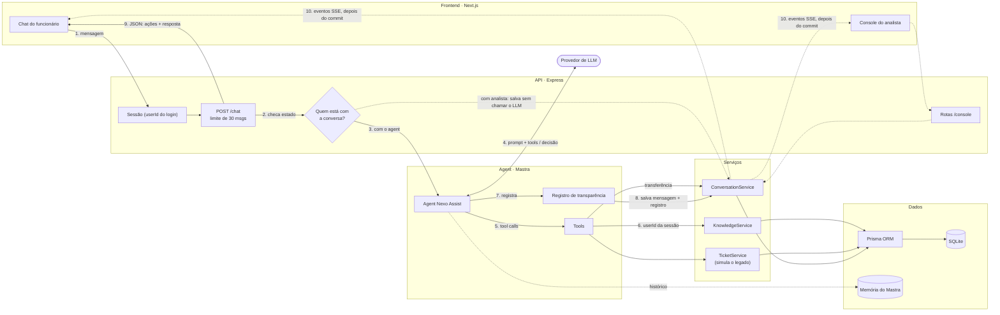

# Nexo Assist

Agent de atendimento do service desk de TI da Nexo. O funcionário descreve o problema no chat e o agent tira dúvidas pela central de ajuda, consulta, abre ou complementa chamados e transfere a conversa para um analista quando precisa.

> Projeto em desenvolvimento. As seções marcadas como _a definir_ serão preenchidas ao longo da implementação.

## Arquitetura



A versão completa e editável está em [`docs/architecture/system-design.drawio`](docs/architecture/system-design.drawio) (abre no [draw.io](https://app.diagrams.net)).

### Princípios

- **O LLM decide, o código garante.** O modelo escolhe qual tool chamar e com quais argumentos. A pausa do agent, o limite de mensagens, a confirmação antes de qualquer escrita e a privacidade são verificados pela API e pelos serviços.
- **O agent não acessa o banco.** As tools chamam serviços (`TicketService`, `KnowledgeService`, `ConversationService`), e só os serviços usam o Prisma.
- **O usuário vem da sessão.** O `userId` nunca é um argumento preenchido pelo LLM, então um funcionário não consegue ver chamados de outro.
- **O serviço de chamados é separado do agent** e simula o sistema legado, com latência e falhas tratadas por timeout e retry.
- **Toda resposta é explicável.** Cada mensagem do agent guarda o que ele entendeu, quais ações tomou, com que confiança e por quê.

## Stack

| Camada | Tecnologias |
|---|---|
| Frontend | Next.js, TypeScript, Zod, React Hook Form, Zustand, TanStack Query, Feature-Sliced Design |
| Backend | Express, TypeScript, Prisma, SQLite |
| Agent | Mastra |
| Modelo | Google Gemini (`gemini-3.5-flash-lite`, pelo Google AI Studio) |

## Estrutura

```
nexo-assist/
├── frontend/          Chat do funcionário e console do analista
└── backend/src/
    ├── api/           Rotas Express (sessão, chat, console, central de ajuda)
    ├── auth/          Login simulado e token de sessão
    ├── agent/         Agent Mastra, tools e instruções
    ├── conversations/ Estados da conversa, transferência e atendimento do analista
    ├── console/       Serviço do console do analista
    ├── realtime/      Barramento de eventos e streams SSE
    ├── tickets/       Serviço de chamados simulado
    ├── knowledge/     Central de ajuda
    ├── db/            Conexão e seed (schema e migrations em backend/prisma)
    └── shared/        Tipos compartilhados
```

## Como rodar

Pré-requisito: Node.js 22.13+.

```bash
cd backend
cp .env.example .env   # preencha LLM_API_KEY: sem ela a API não sobe (veja "Variáveis de ambiente")
npm install            # também gera o Prisma Client
npm run db:setup       # aplica as migrations, gera o client e popula com dados de demonstração
npm run dev            # API em http://localhost:8000 (GET /health)
```

Em outro terminal, suba o frontend:

```bash
cd frontend
cp .env.example .env.local   # API_PROXY_TARGET=http://localhost:8000
npm install
npm run dev                  # http://localhost:3000 (login em /login)
```

O navegador só fala com o Next: as chamadas a `/api/*` são reescritas para `API_PROXY_TARGET`, e por isso o cookie de sessão fica no domínio do frontend.

| Variável (`frontend/`) | Obrigatória | Descrição |
|---|---|---|
| `API_PROXY_TARGET` | No build de produção | URL do backend, sem barra final. Os rewrites são gravados no build: sem ela, `npm run build` falha. Em `npm run dev`, o padrão é `http://localhost:8000` |

Outros comandos úteis (em `backend/`):

| Comando | O que faz |
|---|---|
| `npm test` | Testes de regras, serviços e rotas |
| `npm run typecheck` | Checagem de tipos |
| `npm run db:seed` | Recria os dados de demonstração (pode rodar quantas vezes quiser) |
| `npm run db:migrate` | Cria e aplica uma nova migration após mudar o schema |
| `npm run db:reset` | Apaga o banco e recria do zero |
| `npm run db:studio` | Abre o Prisma Studio |

Usuários de demonstração (login simulado, sem senha): `marina.costa@nexo.example`, `juliana.alves@nexo.example` e `ana.souza@nexo.example` (funcionários); `rafael.lima@nexo.example` e `bruno.martins@nexo.example` (analistas).

## Autenticação

O login é simulado: o backend valida apenas se o e-mail existe e ignora a senha enviada. A sessão fica em um cookie `httpOnly` (`nexo_session`) válido por 8 horas, sem renovação automática, e sobrevive a reinícios da API.

| Rota | Body | Resposta de sucesso |
|---|---|---|
| `POST /auth/login` | `{ "email": string }` | `200` com `{ "user": ... }` e o cookie de sessão |
| `GET /auth/me` | nenhum (usa o cookie) | `200` com `{ "user": ... }` |
| `POST /auth/logout` | nenhum | `204` sem body; limpa o cookie, com ou sem sessão válida |

Erros seguem o formato `{ "error": { "code": "...", "message": "..." } }`.

## Chat

`POST /chat` recebe a mensagem do funcionário e devolve a resposta do agent em JSON. Usa o cookie de sessão e aceita só usuários com papel `EMPLOYEE`.

```json
{ "message": "Cadê meu chamado?", "conversationId": "opcional" }
```

Sem `conversationId` cria uma conversa; com ele, continua. `message` tem de 1 a 2000 caracteres, e qualquer campo extra é recusado.

| Código | `error.code` | Quando |
|---|---|---|
| `200` | | `{ conversation, employeeMessage, message, ticketLookup, ticketDraft, quickReplies }` |
| `400` | `INVALID_REQUEST` | Body inválido |
| `401` | `SESSION_MISSING`, `SESSION_INVALID` | Sem sessão válida |
| `403` | `FORBIDDEN` | Usuário não é funcionário |
| `404` | `CONVERSATION_NOT_FOUND` | Conversa inexistente ou de outro dono |
| `409` | `CONVERSATION_MESSAGE_LIMIT_REACHED` | Conversa já tem 30 mensagens do funcionário enviadas ao agent; nada é gravado |
| `409` | `CONVERSATION_CLOSED` | Conversa encerrada |
| `503` | `AGENT_UNAVAILABLE` | Falha da LLM; o turno é desfeito |
| `500` | `INTERNAL_ERROR` | Erro inesperado; o turno é desfeito |

O envelope:

- `conversation`: `{ id, status, messageCount, messageLimit, remainingMessages, analyst }`. `analyst` é `{ id, name }` ou `null`. `messageCount` conta só as mensagens do funcionário enviadas com a conversa no agent (`WITH_AGENT`), e `remainingMessages` é o que resta dessa cota.
- `employeeMessage`: a mensagem gravada do funcionário (`{ id, authorType: "EMPLOYEE", content, createdAt }`). O `id` substitui o do item otimista e deduplica com o tempo real.
- `message`: a resposta do agent, ou `null` quando a conversa está com analista.
- `ticketLookup`, `ticketDraft` e `quickReplies`: `null` quando a conversa está com analista. `quickReplies` traz atalhos de resposta.

`GET /chat/conversations/:id` devolve `{ conversation, messages }` com todas as mensagens em ordem cronológica, inclusive `ANALYST` (com `author`) e `SYSTEM`. O `trace` vem só nas do `AGENT`. O formato de cada mensagem está em [Mensagens da linha do tempo](#mensagens-da-linha-do-tempo). A rota aceita só o dono, com papel `EMPLOYEE`. Conversa de outra pessoa responde `404 CONVERSATION_NOT_FOUND`, igual a inexistente, e um analista recebe `403 FORBIDDEN`. Serve para ressincronizar depois de um `sync RESYNC` e como polling de reserva.

### Transferência para analista

A conversa vai para a fila dos analistas (`status: WAITING_ANALYST`) em dois casos:

- **O agent decide transferir:** pedido do funcionário, chamado vencido aceito pela pessoa, ou baixa confiança. A transferência acontece junto com a resposta do agent.
- **Confirmação de chamado com prioridade final `CRITICAL`:** a transferência é automática, com um resumo montado pelo backend.

Em qualquer caso, o rascunho pendente é descartado e a conversa ganha a mensagem `SYSTEM` "Transferida para um analista". O `conversation.status` de `POST /chat` e da confirmação reflete o estado depois da operação. A mensagem `SYSTEM` não vem nessas respostas: ela chega pelo tempo real (`message.created`) e já está no histórico de `GET /chat/conversations/:id`. Quando `status` chega como `WAITING_ANALYST`, o frontend mostra um aviso, sem travar o composer.

Enquanto a conversa está com analista (`WAITING_ANALYST` ou `WITH_ANALYST`), `POST /chat` com o `conversationId` só grava a mensagem do funcionário, sem chamar o LLM, e responde `200` com `message: null`.

- **Limite:** a mensagem ao analista não conta em `messageCount` e é aceita mesmo com a cota em 0. A cota é de custo do LLM, então só as mensagens ao agent gastam.
- **Volta ao agent:** depois que o analista devolve a conversa, o próximo `POST /chat` volta a ir ao agent, com a cota de onde parou antes da transferência. Só com as 30 mensagens ao agent já usadas ele recebe `409 CONVERSATION_MESSAGE_LIMIT_REACHED`, e o funcionário abre outra conversa.
- **Devolvida por quem assumiu:** se um analista assumiu e depois devolveu, o agent passa a transferir de novo só com pedido explícito do funcionário. Devolvida da fila sem ninguém assumir, o agent segue normal, a menos que a conversa já tenha sido devolvida antes por quem assumiu.
- **Encerrada pelo analista:** `POST /chat` responde `409 CONVERSATION_CLOSED`.

### Mensagens da linha do tempo

As mensagens de `GET /chat/conversations/:id`, de `GET /console/conversations/:id/messages`, de `POST /console/conversations/:id/messages` e do evento `message.created` têm o mesmo formato:

```ts
{
  id: string;
  authorType: "EMPLOYEE" | "AGENT" | "ANALYST" | "SYSTEM";
  systemKind: "HANDOFF" | "TAKEOVER" | "RETURNED" | "CLOSED" | null;
  author: { id: string; name: string } | null; // EMPLOYEE e ANALYST; null em AGENT e SYSTEM
  content: string;
  createdAt: string; // ISO
  trace: AgentTrace | null; // só em AGENT
}
```

`systemKind` diz qual aviso é uma mensagem `SYSTEM` e é `null` em todas as outras. O frontend decide por ele, nunca pelo texto de `content`, que é só para exibir.

| `systemKind` | Quando | `content` |
|---|---|---|
| `HANDOFF` | A conversa foi para a fila dos analistas | "Transferida para um analista" |
| `TAKEOVER` | Um analista assumiu | "`<Primeiro nome>` assumiu a conversa" |
| `RETURNED` | Um analista devolveu ao agent | "Conversa devolvida ao agent" |
| `CLOSED` | O analista encerrou o atendimento | "`<Primeiro nome>` encerrou o atendimento" |

O valor é gravado junto com a mensagem. As mensagens antigas foram preenchidas pela migração `message_system_kind`, pelos textos fixos.

`trace.sources` (opcional) lista os artigos da central de ajuda citados na resposta: `[{ kind: "ARTICLE", slug, title }]`, no máximo 3. Traces antigos não têm o campo. O card do artigo sai daqui e abre o texto completo por `GET /help/articles/:slug` (veja [Central de ajuda](#central-de-ajuda)).

### Rascunhos: complementar e abrir chamado

O agent nunca grava no chamado: ele propõe um rascunho, que chega em `ticketDraft` no envelope de `POST /chat`, ou `null` se o turno não propôs nenhum. Cada conversa guarda um rascunho: um novo substitui o anterior. Se o backend não conseguir validar um complemento, a proposta é descartada e a resposta passa a dizer isso.

| `kind` | Campos de `ticketDraft`, além de `id` |
|---|---|
| `COMPLEMENT` | `ticket`, `content` |
| `CREATE` | `type`, `category`, `priority`, `title`, `description`, `affectedScope`, `affectedDescription` (opcional), `dueAtPreview` |
| `REOPEN` | `ticket` (com `status` e `canReopen`), `reason`, `dueAtPreview` |

| Rota | Body | Resposta de sucesso |
|---|---|---|
| `POST /chat/drafts/:id/confirm` | Depende do `kind`, abaixo | `200` com `{ message, ticket, conversation: { id, status } }` |
| `POST /chat/drafts/:id/cancel` | vazio | `200` com `{ message }` |

```json
{ "kind": "COMPLEMENT", "content": "texto de 1 a 2000 caracteres" }
```

```json
{ "kind": "CREATE", "title": "até 120", "description": "até 2000", "affectedScope": "INDIVIDUAL | TEAM | COMPANY", "affectedDescription": "opcional" }
```

```json
{ "kind": "REOPEN", "reason": "texto de 1 a 2000 caracteres" }
```

- **Complemento:** o `content` confirmado é o que vale, então a pessoa pode ajustar o texto. Ele vira um comentário no histórico do chamado e não altera a descrição original nem o prazo. A exceção é o chamado em `WAITING_EMPLOYEE`: como o analista esperava essa resposta, o sistema o devolve para `WAITING_ANALYST` (evento `STATUS_CHANGED` com ator `SYSTEM`) e o prazo recomeça da hora da confirmação.
- **Reabertura:** só chamado resolvido há até 7 dias. O `reason` confirmado é o que vale e fica no histórico do chamado. A prioridade original é mantida, e o prazo recomeça da hora da confirmação.
- **Abertura:** só título, descrição e afetados são editáveis. Tipo, categoria e prioridade ficam como no rascunho, e o prazo real conta da hora da confirmação. A prioridade `CRITICAL` exige escopo `TEAM` ou `COMPANY`: com `INDIVIDUAL`, o chamado fica `HIGH`.

As duas rotas exigem sessão de funcionário, não chamam o modelo e não contam no limite de 30 mensagens. Cancelar não consome número de chamado.

| Código | `error.code` | Quando |
|---|---|---|
| `400` | `INVALID_REQUEST` | Body inválido, ou `kind` diferente do rascunho |
| `401` | `SESSION_MISSING`, `SESSION_INVALID` | Sem sessão válida |
| `403` | `FORBIDDEN` | Usuário não é funcionário |
| `404` | `DRAFT_NOT_FOUND` | Rascunho inexistente, já usado ou de outro dono |
| `409` | `TICKET_NOT_OPEN` | Chamado resolvido; o rascunho é mantido |
| `409` | `TICKET_NOT_REOPENABLE` | Reabertura fora da janela de 7 dias, ou chamado já reaberto; o rascunho é mantido |
| `409` | `CONVERSATION_NOT_WITH_AGENT` | Conversa fora do agent; o rascunho é mantido |
| `503` | `TICKET_SERVICE_UNAVAILABLE` | Só na confirmação; o rascunho é mantido e pode tentar de novo |
| `500` | `INTERNAL_ERROR` | Erro inesperado; nada é gravado e o rascunho é mantido |

`ticketLookup` vem do serviço de chamados, nunca do texto do modelo, e é `null` quando nenhuma consulta rodou. A consulta só enxerga chamados abertos do dono da sessão.

O seed traz conversas com ids fixos para demonstração:

| Id | Dono | Estado |
|---|---|---|
| `seed-conv-closed` | Marina | Encerrada, sem analista |
| `seed-conv-near-limit` | Marina | Com o agent, com 29 mensagens: a próxima é aceita e a seguinte recebe o `409` |
| `seed-conv-waiting` | Juliana | Esperando analista (chamado crítico) |
| `seed-conv-request` | Ana | Esperando analista (pedido da pessoa) |
| `seed-conv-low-confidence` | Juliana | Esperando analista (baixa confiança) |
| `seed-conv-overdue` | Marina | Esperando analista (chamado vencido, `ticketCode` INC-20311) |
| `seed-conv-returned` | Ana | Atendida pelo Bruno e devolvida ao agent |
| `seed-conv-closed-by-analyst` | Juliana | Encerrada pelo Rafael há 3 h |
| `seed-conv-with-analyst` | Rafael | Atendida pelo Bruno (`WITH_ANALYST`), com o INC-20405 ainda aguardando analista |

O dono de `seed-conv-with-analyst` é o Rafael, que é analista, então ela só serve para o console. É a conversa da demo de [Chamados no console](#chamados-no-console): o Bruno assumiu, mas ainda não mexeu no chamado.

## Console do analista

Rotas em `/console`, só para usuários com papel `ANALYST`. Quem não é analista recebe `403 FORBIDDEN`. Qualquer analista lê qualquer conversa, porque a fila é compartilhada. O analista de cada ação vem sempre da sessão.

| Rota | Body | Resposta de sucesso |
|---|---|---|
| `GET /console/conversations` | query `filter` (`all`, `waiting`, `with-agent`, `mine`) e `q` (opcionais) | `{ conversations }` |
| `GET /console/conversations/:id` | | `{ conversation }` |
| `GET /console/conversations/:id/messages` | | `{ messages }`, todas, em ordem cronológica |
| `GET /console/conversations/:id/tickets` | | `{ conversationTicket, otherTickets }` |
| `POST /console/conversations/:id/takeover` | vazio ou `{}` | `{ conversation }` |
| `POST /console/conversations/:id/messages` | `{ "content": "1 a 2000 caracteres" }` | `{ message, conversation }` |
| `POST /console/conversations/:id/return` | vazio ou `{}` | `{ conversation }` |
| `POST /console/conversations/:id/close` | vazio ou `{}` | `{ conversation }` |

**Conversa no console:**

- Campos: `id`, `status`, `owner` (com `department`), `analyst`, `assignedToMe`, `assignedAt`, `handoffReason`, `handoffSummary`, `handoffAt`, `lastMessageAt`, `closedAt`, `messageCount`, `messageLimit`, `lastMessage` (a última que não é `SYSTEM`), `lastAgentConfidence` e `ticketCode`.
- `assignedToMe` é calculado para o analista da sessão.

**Lista:**

- Traz as conversas não encerradas e as encerradas nas últimas 48 h, por `lastMessageAt` decrescente, até 200.
- `q` busca no nome do dono ou no `ticketCode`, sem diferenciar acento nem caixa. A busca roda antes do corte de 200, então acha também conversas mais antigas que as 200 mais recentes.

**`ticketCode`:**

1. É o chamado do evento mais recente ligado à conversa.
2. Sem evento, vale o primeiro código `INC-`/`REQ-` do resumo da transferência que seja de um chamado do mesmo dono.
3. Senão, `null`.

**Chamados:** `conversationTicket` é o chamado de `ticketCode`, e `otherTickets` traz os demais do dono: abertos primeiro, depois os resolvidos. Cada chamado traz `dueAt` (null com o prazo pausado ou resolvido) e `overdue`. Só essa rota depende do serviço de chamados. Com ele fora do ar, ela responde `503` e a lista continua respondendo.

**Ações:**

| Ação | Vale em | Efeito | Mensagem `SYSTEM` (`systemKind`: `content`) |
|---|---|---|---|
| Assumir | `WAITING_ANALYST` | Vai para `WITH_ANALYST` com o analista da sessão | `TAKEOVER`: "`<Primeiro nome>` assumiu a conversa" |
| Responder | `WITH_ANALYST`, assumida por mim | Grava a mensagem `ANALYST` | |
| Devolver | `WAITING_ANALYST`, ou `WITH_ANALYST` assumida por mim | Volta a `WITH_AGENT` e limpa analista e transferência. Só a devolução de quem assumiu liga o modo "devolvida por analista" do agent | `RETURNED`: "Conversa devolvida ao agent" |
| Encerrar | `WITH_ANALYST`, assumida por mim | Vai para `CLOSED`; o chamado não muda, e analista e transferência ficam como registro | `CLOSED`: "`<Primeiro nome>` encerrou o atendimento" |

**Concorrência e idempotência:**

- Cada ação é uma transação condicional ao estado esperado.
- Se dois analistas assumem ao mesmo tempo, um vence e o outro recebe `409 CONVERSATION_NOT_WAITING`.
- Assumir de novo (duplo clique) ou encerrar de novo pelo mesmo analista responde `200` com o estado atual, sem nova mensagem.
- Devolver não é idempotente: a segunda chamada encontra `WITH_AGENT` e recebe `409`.

| Código | `error.code` | Quando |
|---|---|---|
| `400` | `INVALID_REQUEST` | Query ou body inválido, ou campo extra |
| `401` | `SESSION_MISSING`, `SESSION_INVALID` | Sem sessão válida |
| `403` | `FORBIDDEN` | Usuário não é analista |
| `404` | `CONVERSATION_NOT_FOUND` | Conversa inexistente |
| `409` | `CONVERSATION_NOT_WAITING` | Assumir ou devolver uma conversa que já não está esperando, ou que é de outro analista |
| `409` | `CONVERSATION_NOT_ASSIGNED` | Responder ou encerrar sem ter assumido |
| `503` | `TICKET_SERVICE_UNAVAILABLE` | Só em `/tickets` |
| `500` | `INTERNAL_ERROR` | Erro inesperado; nada é gravado |

## Chamados no console

O analista muda o status do chamado pelo console. As rotas são centradas no chamado, não na conversa, e seguem as regras do console: sessão de `ANALYST` (`403` antes de qualquer `400`), `Cache-Control: no-store` e ator sempre da sessão. Qualquer analista muda qualquer chamado, inclusive um que seja dele mesmo como dono (risco de segregação de funções aceito na v1).

| Rota | Body | Resposta de sucesso |
|---|---|---|
| `GET /console/tickets/:code` | | `{ ticket }` (`ConsoleTicketDetail`) |
| `POST /console/tickets/:code/status` | abaixo | `{ ticket, changed }` |

O `:code` não diferencia maiúsculas (`inc-20405` vale).

```json
{ "toStatus": "IN_PROGRESS | WAITING_EMPLOYEE | APPROVED | RESOLVED", "expectedStatus": "status que a tela mostrava", "note": "até 1000 caracteres", "conversationId": "opcional" }
```

- **`expectedStatus`** protege contra duplo clique e contra outro analista: se o chamado já está em `toStatus`, responde `200` com `changed: false` e não grava nada; se está em outro status, `409 TICKET_STATUS_CONFLICT`.
- **`note`** é obrigatória para `WAITING_EMPLOYEE` (o que falta do funcionário) e `RESOLVED` (a solução), e opcional nos demais. Sem nota, omita o campo: `""` ou só espaços dão `400`. Fica no `content` do evento `STATUS_CHANGED`, é interna e só os analistas veem: não vai para o chat nem para o agent.
- **`conversationId`** liga o evento à conversa de onde o analista agiu. Precisa ser do dono do chamado.
- O funcionário não é avisado no chat; ele vê o status novo quando pergunta ao agent.

**Transições do analista** (`allowedStatuses` já traz as válidas para o chamado):

| De \ Para | `IN_PROGRESS` | `WAITING_EMPLOYEE` | `APPROVED` (só REQ) | `RESOLVED` |
|---|---|---|---|---|
| `WAITING_ANALYST` | sim | sim | sim | sim |
| `IN_PROGRESS` | | sim | sim | sim |
| `WAITING_EMPLOYEE` | sim | | não | sim |
| `APPROVED` | sim | sim | | sim |
| `RESOLVED` | não | não | não | não |

O analista não devolve o chamado à fila nem reabre: `RESOLVED` só sai pela reabertura do funcionário, em até 7 dias.

**Prazo:**

- `IN_PROGRESS` e `APPROVED` abrem uma janela nova e cheia a partir da mudança, então marcar "Em andamento" tira o "vencido".
- `WAITING_EMPLOYEE` pausa: `dueAt` e `slaStartedAt` ficam null e o chamado nunca aparece vencido (`slaPaused: true`).
- `RESOLVED` grava `resolvedAt` e zera o prazo.
- Quando o funcionário confirma um complemento num chamado em `WAITING_EMPLOYEE`, o sistema o devolve para `WAITING_ANALYST` com janela nova.

**Detalhe (`ConsoleTicketDetail`):** os campos de `ConsoleTicket` (`code`, `type`, `category`, `priority`, `status`, `statusLabel`, `title`, `createdAt`, `resolvedAt`, `dueAt`, `overdue`) mais `description`, `affectedScope`, `affectedDescription`, `owner` (com `department`), `updatedAt`, `slaStartedAt`, `slaPaused`, `allowedStatuses`, `statusNoteRequired` e `events`: o histórico em ordem cronológica, até os 200 mais recentes, cada um com `type`, `actorType`, `actor` (null para AGENT e SYSTEM), `content`, `fromStatus`, `toStatus`, `fromPriority`, `toPriority`, `dueAt`, `conversationId` e `createdAt`.

Cada mudança é uma transação condicional ao `expectedStatus`, com o evento gravado junto. Depois do commit, e só se algo mudou, sai `tickets.changed` com o `ticketCode` em `/console/events`.

| Código | `error.code` | Quando |
|---|---|---|
| `400` | `INVALID_REQUEST` | Body inválido ou com campo extra, nota obrigatória ausente, `conversationId` inexistente ou de outro dono |
| `401` | `SESSION_MISSING`, `SESSION_INVALID` | Sem sessão válida |
| `403` | `FORBIDDEN` | Usuário não é analista |
| `404` | `TICKET_NOT_FOUND` | Chamado inexistente ou código fora do formato |
| `409` | `TICKET_STATUS_CONFLICT` | O status mudou desde que a tela foi carregada |
| `409` | `TICKET_TRANSITION_NOT_ALLOWED` | Transição fora da tabela (ex.: `APPROVED` em INC, qualquer saída de `RESOLVED`) |
| `503` | `TICKET_SERVICE_UNAVAILABLE` | Serviço de chamados fora do ar (inclusive com `TICKET_SERVICE_SIMULATION=down`); nada é gravado |

**Demo:** entre como Bruno, abra `seed-conv-with-analyst` e marque o INC-20405 como "Em andamento".

```bash
curl -c cookies.txt -H "Content-Type: application/json" -d "{\"email\":\"bruno.martins@nexo.example\"}" http://localhost:8000/auth/login
curl -b cookies.txt http://localhost:8000/console/tickets/INC-20405
curl -b cookies.txt -H "Content-Type: application/json" \
  -d "{\"toStatus\":\"IN_PROGRESS\",\"expectedStatus\":\"WAITING_ANALYST\",\"conversationId\":\"seed-conv-with-analyst\"}" \
  http://localhost:8000/console/tickets/INC-20405/status
```

## Central de ajuda

Artigos de autoatendimento (tabela `Article`, 8 no seed). A busca é para a tool `searchHelpCenter` do agent (em implementação); não há rota HTTP de busca. A busca roda em memória (`knowledge/article-search.ts`, módulo puro):

- As keywords buscadas são normalizadas (minúsculas, sem acento), sem repetidas e sem termos genéricos ("erro", "problema", "não funciona"...). Sem nenhuma significativa, o resultado é vazio, nunca a base inteira.
- Cada keyword vale o maior casamento, sem somar: 3 se uma keyword do artigo for igual ou a contiver como frase, 2 no título, 1 no texto. O casamento respeita fronteira de palavra ("rede" não casa "redefinir").
- A categoria, se vier, dá 1 de bônus; não filtra.
- Entram os artigos com 3 pontos ou mais, por pontuação, número de keywords casadas e slug, até 3, com o conteúdo cortado em 2000 caracteres.

A leitura tem timeout de 2 s e 2 tentativas; esgotadas, a busca falha com `KnowledgeUnavailableError` (a tool deve tratá-la como `UNAVAILABLE`, sem quebrar o turno).

`GET /help/articles/:slug` devolve `{ article: { slug, title, category, content, updatedAt } }`, com o conteúdo completo. Aceita qualquer papel com sessão e responde `Cache-Control: no-store`.

| Código | `error.code` | Quando |
|---|---|---|
| `401` | `SESSION_MISSING`, `SESSION_INVALID` | Sem sessão válida |
| `404` | `ARTICLE_NOT_FOUND` | Artigo inexistente ou slug fora de `^[a-z0-9-]{1,80}$` |
| `503` | `HELP_CENTER_UNAVAILABLE` | Base de artigos fora do ar depois das tentativas |

```bash
curl -c cookies.txt -H "Content-Type: application/json" -d "{\"email\":\"ana.souza@nexo.example\"}" http://localhost:8000/auth/login
curl -b cookies.txt http://localhost:8000/help/articles/vpn-erro-809
```

## Tempo real

Dois streams SSE, um por papel. O envio continua pelos `POST`.

| Rota | Quem | Recebe |
|---|---|---|
| `GET /chat/events` | `EMPLOYEE` | Eventos das próprias conversas |
| `GET /console/events` | `ANALYST` | Eventos de todas as conversas |

Antes de o stream abrir, os erros saem em JSON: `401`, `403` e `429 TOO_MANY_STREAMS`, quando o mesmo usuário já tem 5 streams abertos.

| Evento | `data` |
|---|---|
| `sync` | `{ mode: "REPLAY" \| "RESYNC" }`. É sempre o primeiro evento |
| `message.created` | `{ conversationId, message }`, no formato de [Mensagens da linha do tempo](#mensagens-da-linha-do-tempo), com `systemKind` |
| `conversation.updated` | `{ conversation }`: `ChatConversationView` para o funcionário, `ConsoleConversation` completa (com `assignedToMe` de quem recebe) para o analista |
| `tickets.changed` | `{ conversationId, ownerId, ticketCode }`. Só para analistas: os chamados do dono mudaram. `conversationId` é null quando a mudança não veio de uma conversa, e `ticketCode` é null só se não se sabe qual chamado foi |
| `session.expired` | `{}`. A sessão venceu e o servidor encerra o stream |

- **Depois do commit:** os eventos só saem depois que a transação grava. No turno do agent, a mensagem do funcionário chega aos analistas junto com a resposta, porque um turno desfeito a apaga.
- **Heartbeat:** um comentário `: ping` a cada 20 s mantém a conexão viva atrás do proxy do Next, que derruba conexões ociosas em 130 s.
- **Reconexão:** o `EventSource` reenvia o `Last-Event-ID` sozinho, e a query `?lastEventId=` também é aceita. Se o id ainda está no buffer (os últimos 1000 eventos), chega `sync REPLAY` e só o que foi perdido. Senão, chega `sync RESYNC` e o cliente recarrega pelos `GET`.
- **Cliente lento:** quem acumula mais de 256 KB sem ler é desconectado e reconecta pelo mesmo caminho.
- **Limite:** o barramento fica em memória, então vale para uma única instância da API, e um reinício sempre leva a `RESYNC`. Com várias instâncias, o mesmo contrato precisaria de uma tabela outbox com sequência global e pub/sub.

## Variáveis de ambiente

Em `backend/.env`:

| Variável | Obrigatória | Descrição |
|---|---|---|
| `DATABASE_URL` | Sim | Banco SQLite, ex.: `file:./dev.db`. Caminho relativo: rode a API a partir de `backend/` |
| `SESSION_SECRET` | Sim | Segredo que assina a sessão, com no mínimo 32 caracteres. O valor do `.env.example` é recusado em produção |
| `CORS_ORIGINS` | Sim | Origens exatas do frontend, separadas por vírgula, sem `*` e sem barra final |
| `LLM_API_KEY` | Sim | Chave do Google AI Studio usada pelo agent |
| `AGENT_MODEL` | Não | Modelo no formato `provider/modelo`; o padrão é `google/gemini-3.5-flash-lite` |
| `AGENT_TIMEOUT_MS` | Não | Limite do turno inteiro do agent, em milissegundos; o padrão é `120000` |
| `TICKET_SERVICE_SIMULATION` | Não | `off` (padrão) ou `down`, que simula o serviço de chamados fora do ar. `down` é recusado em produção |
| `NODE_ENV` | Não | `production` envia o cookie só por HTTPS (`Secure`) |
| `PORT` | Não | Porta da API; o padrão é `8000` |

## Como o agent decide o que fazer

_A definir._

## Qualidade das decisões

_A definir._

## Trade-offs

_A definir._

## Com mais tempo

_A definir._

## Uso de IA no desenvolvimento

_A definir._
