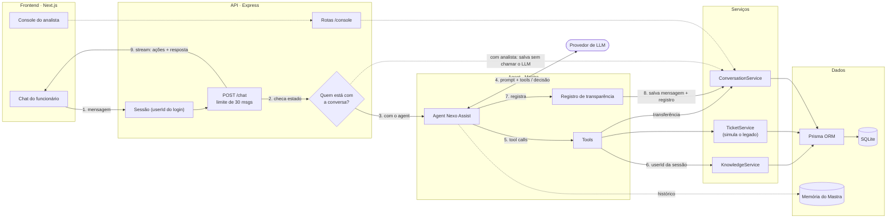

# Nexo Assist

Agent de atendimento do service desk de TI da Nexo. O funcionário descreve o problema no chat e o agent tira dúvidas pela central de ajuda, consulta, abre ou complementa chamados e transfere a conversa para um analista quando precisa.

> Projeto em desenvolvimento. As seções marcadas como _a definir_ serão preenchidas ao longo da implementação.

## Arquitetura



A versão completa e editável está em [`docs/architecture/system-design.drawio`](docs/architecture/system-design.drawio) (abre no [draw.io](https://app.diagrams.net)).

### Princípios

- **O LLM decide, o código garante.** O modelo escolhe qual tool chamar e com quais argumentos. A pausa do agent, o limite de mensagens, a confirmação antes de qualquer escrita e a privacidade são verificados pela API e pelos serviços.
- **O agent não acessa o banco.** As tools chamam serviços (`TicketService`, `KnowledgeService`, `ConversationService`), e só os serviços usam o Prisma.
- **O usuário vem da sessão.** O `userId` nunca é um argumento preenchido pelo LLM, então um funcionário não consegue ver chamados de outro.
- **O serviço de chamados é separado do agent** e simula o sistema legado, com latência e falhas tratadas por timeout e retry.
- **Toda resposta é explicável.** Cada mensagem do agent guarda o que ele entendeu, quais ações tomou, com que confiança e por quê.

## Stack

| Camada | Tecnologias |
|---|---|
| Frontend | Next.js, TypeScript, Zod, React Hook Form, Zustand, TanStack Query, Feature-Sliced Design |
| Backend | Express, TypeScript, Prisma, SQLite |
| Agent | Mastra |
| Modelo | _a definir_ |

## Estrutura

```
nexo-assist/
├── frontend/          Chat do funcionário e console do analista
└── backend/src/
    ├── api/           Rotas Express (sessão, chat, console)
    ├── auth/          Login simulado e token de sessão
    ├── agent/         Agent Mastra, tools e instruções
    ├── tickets/       Serviço de chamados simulado
    ├── knowledge/     Central de ajuda
    ├── db/            Conexão e seed (schema e migrations em backend/prisma)
    └── shared/        Tipos compartilhados
```

## Como rodar

Pré-requisito: Node.js 22+.

```bash
cd backend
cp .env.example .env   # variáveis descritas em "Autenticação"
npm install            # também gera o Prisma Client
npm run db:setup       # aplica as migrations, gera o client e popula com dados de demonstração
npm run dev            # API em http://localhost:8000 (GET /health)
```

Em outro terminal, suba o frontend:

```bash
cd frontend
cp .env.example .env.local   # API_PROXY_TARGET=http://localhost:8000
npm install
npm run dev                  # http://localhost:3000 (login em /login)
```

O navegador só fala com o Next: as chamadas a `/api/*` são reescritas para `API_PROXY_TARGET`, e por isso o cookie de sessão fica no domínio do frontend.

| Variável (`frontend/`) | Obrigatória | Descrição |
|---|---|---|
| `API_PROXY_TARGET` | No build de produção | URL do backend, sem barra final. Os rewrites são gravados no build: sem ela, `npm run build` falha. Em `npm run dev`, o padrão é `http://localhost:8000` |

Outros comandos úteis (em `backend/`):

| Comando | O que faz |
|---|---|
| `npm test` | Testes das regras de prazo e de chamados |
| `npm run typecheck` | Checagem de tipos |
| `npm run db:seed` | Recria os dados de demonstração (pode rodar quantas vezes quiser) |
| `npm run db:migrate` | Cria e aplica uma nova migration após mudar o schema |
| `npm run db:reset` | Apaga o banco e recria do zero |
| `npm run db:studio` | Abre o Prisma Studio |

Usuários de demonstração (login simulado, sem senha): `marina.costa@nexo.example`, `rafael.lima@nexo.example` e `juliana.alves@nexo.example` (funcionários); `ana.souza@nexo.example` e `bruno.martins@nexo.example` (analistas).

## Autenticação

O login é simulado: o backend valida apenas se o e-mail existe e ignora a senha enviada. A sessão fica em um cookie `httpOnly` (`nexo_session`) válido por 8 horas, sem renovação automática, e sobrevive a reinícios da API.

| Rota | Body | Resposta de sucesso |
|---|---|---|
| `POST /auth/login` | `{ "email": string }` | `200` com `{ "user": ... }` e o cookie de sessão |
| `GET /auth/me` | nenhum (usa o cookie) | `200` com `{ "user": ... }` |
| `POST /auth/logout` | nenhum | `204` sem body; limpa o cookie, com ou sem sessão válida |

Erros seguem o formato `{ "error": { "code": "...", "message": "..." } }`.

Variáveis de ambiente (`backend/.env`):

| Variável | Obrigatória | Descrição |
|---|---|---|
| `DATABASE_URL` | Sim | Banco SQLite, ex.: `file:./dev.db`. Caminho relativo: rode a API a partir de `backend/` |
| `SESSION_SECRET` | Sim | Segredo que assina a sessão, com no mínimo 32 caracteres. O valor do `.env.example` é recusado em produção |
| `CORS_ORIGINS` | Sim | Origens exatas do frontend, separadas por vírgula, sem `*` e sem barra final |
| `NODE_ENV` | Não | `production` envia o cookie só por HTTPS (`Secure`) |
| `PORT` | Não | Porta da API; o padrão é `8000` |

## Como o agent decide o que fazer

_A definir._

## Qualidade das decisões

_A definir._

## Trade-offs

_A definir._

## Com mais tempo

_A definir._

## Uso de IA no desenvolvimento

_A definir._
